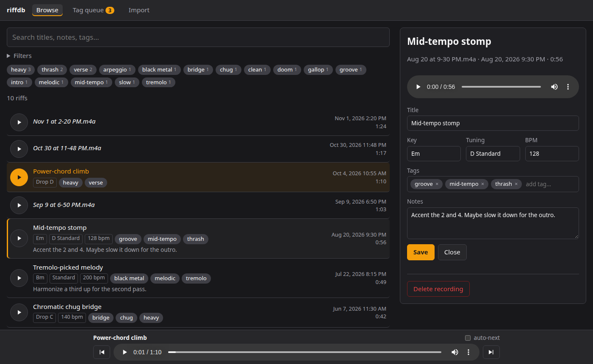
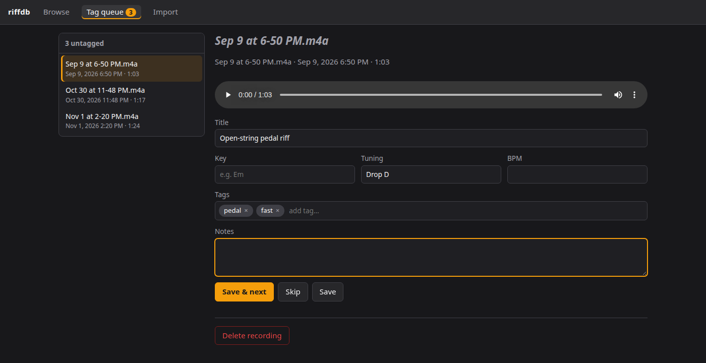
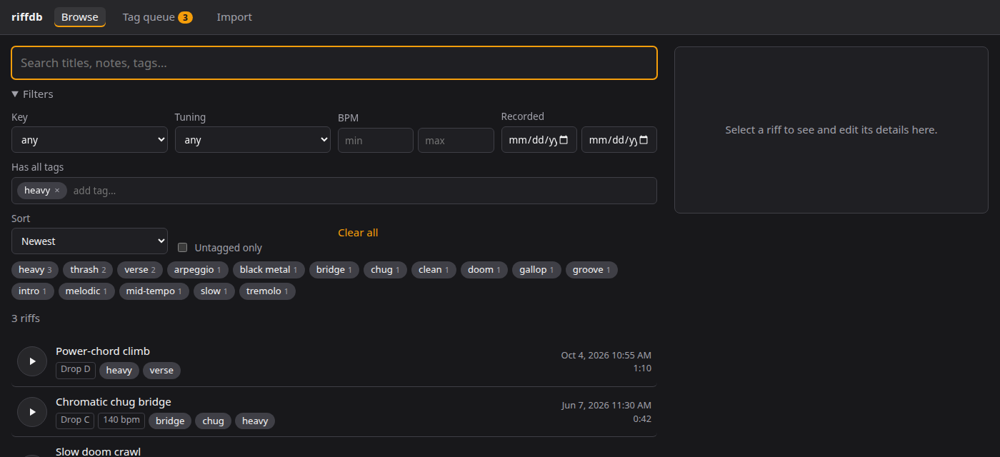
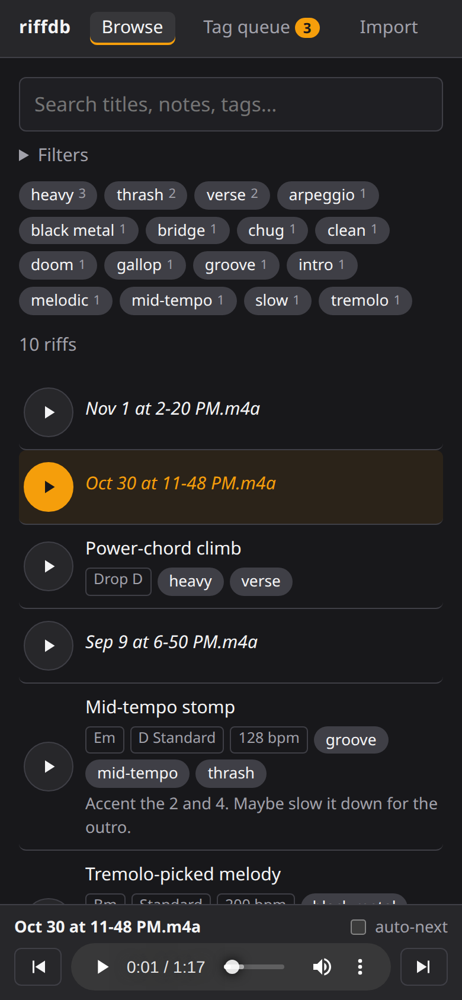

# riffdb

A self-hosted library for your guitar riff recordings. Import the voice memos and phone recordings
you never got around to naming, describe them as you listen, then search and play them straight from
the results — so you can find the riffs that sound like they belong together.

riffdb is a database and search tool, not a DAW: it never edits your audio.



## Features

- **Import from anywhere** — upload files or whole folders from any browser (including your phone), or
  drop files into a watched inbox folder (scp, SMB, Syncthing…) and they're picked up automatically.
  Duplicates are detected by content, so re-importing is safe.
- **Real recording dates** — taken from the filename, the date embedded in the file (phones write
  this), or Google Recorder–style names like `Aug 20 at 9-30 PM`.
- **Describe riffs your way** — title, key, tuning, BPM, free-form tags and notes. Everything is optional.
- **Tag queue** — work through untagged recordings one by one: listen → describe → *Save & next*.
- **Search and filter** — full-text search across titles, notes and tags; filter by key, tuning, BPM
  range, tags and date.
- **Play from the results** — a docked player keeps going while you search, with previous/next and
  auto-advance for auditioning riffs back to back.
- **Readable files on disk** — audio is stored as `2026/2026-08-20 2131 - Riff title [id].m4a` and
  renamed when you retitle it, plus a `riffdb-export.json` with all your metadata. Your library makes
  sense even without the app.
- **Works on phones** — responsive layout; seeking works on mobile.

| Tag queue | Filtering | Mobile |
|---|---|---|
|  |  |  |

## Quick start

You need Docker with the Compose plugin.

```sh
git clone https://github.com/liberty5782/riffdb.git
cd riffdb
mkdir -p data                  # create it first so it's owned by you, not root
docker compose up -d --build
```

Open <http://localhost:8000> (or `http://<server-ip>:8000` from another device on your network),
go to **Import**, and add some recordings.

To use a different port, change the left side of the mapping in `docker-compose.yml`
(e.g. `"7433:8000"`) — the app always listens on 8000 inside the container.

> **Security:** riffdb has no login. Run it on your home network or behind a VPN such as
> [Tailscale](https://tailscale.com/), or put it behind a reverse proxy that adds authentication.
> Don't expose it directly to the internet.

## Getting recordings in

**Upload** (`/import`): pick files or a folder from the device you're on. Good for a handful of files
or a fresh recording from your phone.

**Inbox folder**: anything copied into `data/inbox/` (subfolders are fine) is imported within about
30 seconds and then removed from the inbox. Good for large batches or automation — e.g. point a
Syncthing folder or an SMB share at it.

Supported formats: `m4a`, `mp3`, `wav`, `ogg`, `opus`, `flac`, `aac`, `webm`, `3gp`, `mp4`. Files are
stored untouched; anything that isn't audio is moved to `data/inbox/_imported/`.

### From Google Recorder

Download recordings from [recorder.google.com](https://recorder.google.com) or a
[Google Takeout](https://takeout.google.com) export, unzip, and move the files into `data/inbox/`
(or upload them). Recording dates are read from the files.

### Recording dates

riffdb picks the first of these that's available:

1. A full date in the filename — `20261102_115200`, `2026-11-02 11-52`, `Nov 2, 2026 11:52 AM`
2. The creation time embedded in the file (written by phones and most recorders)
3. A Google Recorder–style name without a year — `Aug 20 at 9-30 PM`
4. The file's modification time

If you change how files are named or improve detection, re-derive dates for everything with
`docker compose exec riffdb python -m riffdb.redate` (add `--dry-run` to preview).

## Configuration

Set these in `docker-compose.yml` (or a `.env` file next to it):

| Variable | Default | Meaning |
|---|---|---|
| `RIFFDB_UID` / `RIFFDB_GID` | `1000` | User the container runs as. Match your host user so files in `data/` stay yours (`id -u`, `id -g`). |
| `RIFFDB_INBOX_POLL_S` | `30` | Seconds between inbox scans. `0` disables the watcher (the **Scan now** button still works). |
| `RIFFDB_DATA_DIR` | `/data` | Where data lives inside the container. Change the volume mapping instead to move it on the host. |

The container mounts `/etc/localtime` so dates display in your server's timezone.

## Your data

```
data/
├── riffdb.sqlite        # titles, tags, notes, search index — the source of truth
├── riffdb-export.json   # the same metadata as plain JSON, rewritten on every change
├── audio/
│   └── 2026/
│       └── 2026-08-20 2131 - Mid-tempo stomp [9de8ad7c].m4a
└── inbox/               # drop zone
```

**Back up the whole `data/` folder.** The database is written while the app runs, so rather than
copying the live `riffdb.sqlite`, have your backup take a consistent snapshot first (no need to stop
the container):

```sh
sqlite3 data/riffdb.sqlite ".backup data/riffdb-backup.sqlite"
```

## Updating

```sh
git pull
docker compose up -d --build
```

Database migrations run automatically on startup.

## Development

Requires Python 3.12+ and [uv](https://docs.astral.sh/uv/) (or plain `pip`).

```sh
uv venv && uv pip install -e . pytest httpx
RIFFDB_DATA_DIR=./data .venv/bin/uvicorn riffdb.main:app --reload
.venv/bin/pytest
```

Stack: [FastAPI](https://fastapi.tiangolo.com/) + Jinja2 templates + [htmx](https://htmx.org/),
SQLite with FTS5 via the standard-library `sqlite3`, and [mutagen](https://mutagen.readthedocs.io/)
for audio metadata. No JavaScript build step.

```
riffdb/
├── main.py        # app setup, inbox watcher
├── db.py          # schema, migrations, queries
├── search.py      # search/filter → SQL
├── importer.py    # hashing, dedupe, date detection
├── library.py     # readable filenames, JSON export
├── redate.py      # re-derive recording dates
├── routes/ui.py   # pages and htmx partials
├── templates/
└── static/
```

## Roadmap

Ideas, not promises:

- Sets — ordered lists of riffs to play in sequence while sketching a song
- Record straight from the browser
- A JSON API for other apps (tab viewers, a mobile recorder, DAW scripts)
- Optional audio analysis: estimated BPM/key and "sounds like this" search

## License

riffdb is free software, licensed under the [GNU General Public License v3.0 or later](LICENSE).
You can use, modify and share it; if you distribute a modified version, it must stay under the GPL
with its source available.
